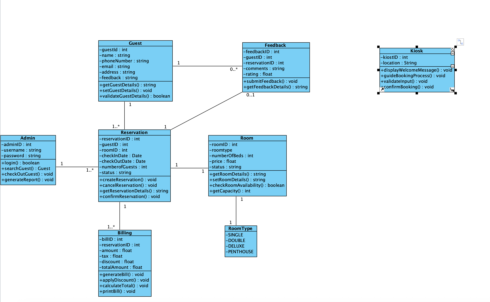

# Hotel Reservation System

A desktop hotel booking app built with JavaFX and SQLite. I made this to get practice building a multi-screen GUI app using MVC and DAO patterns with a local database.

## What it does

The app has two sides:

- **Guest kiosk:** Guests can check which rooms are open (`SINGLE`, `DOUBLE`, `DELUXE`, `PENTHOUSE`), book a stay by picking dates and party size, look up or change a reservation with their phone number, and leave feedback after checking out.
- **Admin dashboard:** Staff log in to manage guest records, assign rooms, handle check-ins and check-outs, generate bills, and look through the activity logs.

## Tech stack

- **Language:** Java 21+
- **UI:** JavaFX 21 (FXML)
- **Database:** SQLite (`sqlite-jdbc`)
- **Build tool:** Maven

## Project structure

```text
src/
├── controller/   # JavaFX controllers, business logic, activity logging
├── dao/          # Database queries and CRUD operations
├── db/           # SQLite connection and table setup
├── model/        # Data classes (Guest, Room, Reservation, Billing, etc.)
├── view/         # FXML layout files
└── Main.java     # Entry point
```

## Architecture and screenshots

### Class diagram


### App preview

#### 1. Start screen and guest kiosk
| Start Window | Kiosk Room Selection |
| :---: | :---: |
|  |  |

| Guest Details Form | Booking Confirmation |
| :---: | :---: |
|  |  |

| Search Booking | Modify Reservation |
| :---: | :---: |
|  |  |

#### 2. Admin side and billing
| Admin Login | Admin Dashboard |
| :---: | :---: |
|  |  |

| Discount Application | Generate Bill |
| :---: | :---: |
|  |  |

#### 3. Checkout and feedback
| Checkout Completed | Feedback Form | Feedback Submitted |
| :---: | :---: | :---: |
|  |  |  |

## Running it locally

You'll need **JDK 21+** and **Maven**.

```bash
git clone https://github.com/your-username/HotelReservationSystem.git
cd HotelReservationSystem
mvn clean javafx:run
```

The first time you run it, the app creates `hotel.db` on its own and fills in the starting room data and the default admin accounts.

### Default admin accounts
- `admin1` / `pass123`
- `admin2` / `pass456`